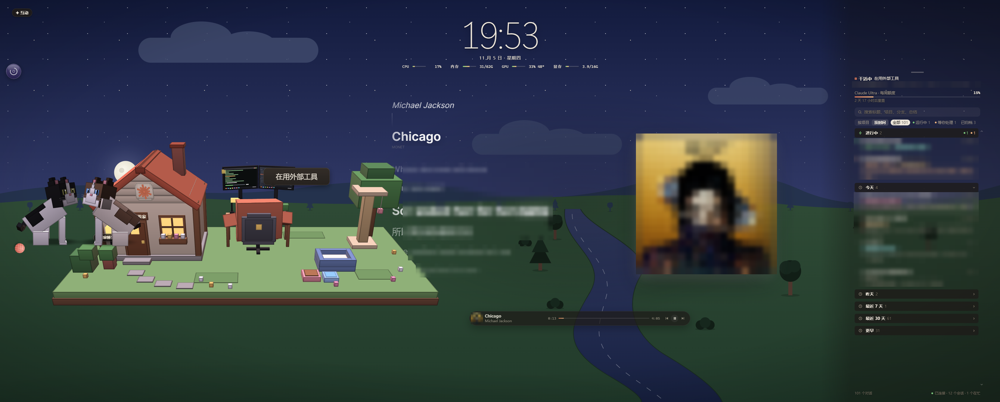

# Wallpaper Engine Claude 伙伴

截图里的对话内容、歌词和专辑封面做了马赛克处理。

一张和 Claude 联动的 [Wallpaper Engine](https://www.wallpaperengine.io/) 网页壁纸：桌面上住着一个 3D 小 Claude 和两只猫，右边管理你所有的 Claude 对话，中间是会跟着歌走的歌词。

> 这是个人爱好项目，**不是 Anthropic 或 Wallpaper Engine 的官方产品**，与它们没有关联。

## 功能

- **小岛和小 Claude**：Claude 干活时它去工位敲键盘，闲着时出来逛、和猫玩，困了回小屋睡觉；可以戳、摸、拖，天色随时间变化。
- **会话管理**：搜索（支持中文输入法）、按时间或项目分组、运行中 / 等你处理 / 出错 / 待验收状态、置顶、子对话，点一下跳到 Claude 桌面版的对话。
- **歌词舞台**：用 [Folia](https://github.com/chthollyphile/folia-major) 的歌词渲染，每首歌随机换一种样式；背景透明，融在壁纸里。
- **额度和系统占用**：Claude 额度和套餐、CPU / 内存 / 显卡。

## 结构

| 目录 | 内容 |
|---|---|
| `wallpaper/` | 壁纸本体。`stage/` 是打包好的歌词舞台，`stage-src/` 是它的打包入口 |
| `bridge/` | 桥接服务（C#，只监听 127.0.0.1）：给壁纸提供会话、歌词、播放进度和系统占用 |
| `mod/` | Claude Code 插件 `desktop-feel`：把 Claude 的状态推给桥接服务 |

## 安装（Windows）

1. 把 `wallpaper/` 复制到 Wallpaper Engine 的 `projects/myprojects/claude-companion`，在 Wallpaper Engine 里选中它。
2. 编译桥接服务：运行 `bridge/build.cmd`（用 Windows 自带的 .NET Framework 编译器）。
3. 在 `bridge/` 里新建 `wallpaper-dir.txt`，写上第 1 步的完整路径（格式见 `wallpaper-dir.example.txt`）。
4. 运行 `claude-wallpaper-bridge.exe`；想开机自启，把它加到启动项。
5. 可选：把 `mod/` 放到 `~/.claude/mods/desktop-feel`，小 Claude 才能跟着 Claude 的状态变化。

播放器支持网易云音乐和 Folia。

## 已知限制

- **网易云不向系统报播放进度**：换歌、暂停、继续能自动同步；在网易云里拖了进度条，要在壁纸的进度条上也拖一下对齐。装 [InfLink-rs](https://docs.lyricify.app/en/lyricify-lite/app-faq/netease-cloud-music/) 插件后，网易云会上报进度，壁纸应该能自动读到（作者没有实测）。
- **倾诉（tilt）样式**显示不出歌词，默认不进随机。
- 放歌时内存占用较高，约 800MB，3D 样式更多；不放歌时舞台会卸载。

## 隐私

会话标题、路径和摘要只在本机读取，由桥接服务通过 127.0.0.1 提供给壁纸，接口要带本机生成的口令。歌词和封面会按歌名和歌手查询网易云、QQ 音乐、酷狗的公开接口。

## 许可证

本仓库用 [AGPL-3.0](LICENSE) 发布，因为歌词舞台打包了同样是 AGPL-3.0 的 [Folia](https://github.com/chthollyphile/folia-major)（版本 `8abd1091`，详见 `wallpaper/stage/NOTICE.txt`）。雾笺样式用到的笔顺数据另有授权，见 `wallpaper/stage/licenses/`。
